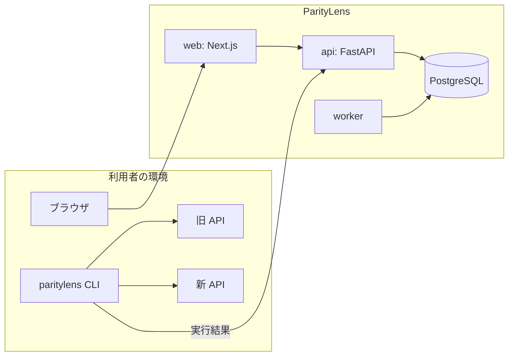

# ParityLens

API migration compatibility testing.

レガシー API を新しい API に置き換えるとき、「同じ入力に対して同じ挙動をするか」を検証するツール。旧 API と新 API に同じリクエストを送り、レスポンスの差異を検出して重大度を付ける。

> **開発状況**: Phase 4(API とデータベース)まで完了。CLI での比較に加えて、プロジェクトやテストケースを API で登録し、サーバー側で実行して結果を保存できる。Web の画面と AI による説明はまだない。進み具合は [Roadmap](#roadmap) を参照。

## Problem

API を書き直すと、誰も決めていない仕様変更が紛れ込む。

- 必須だった項目が、新しい DTO では任意になっている
- 端数処理の順序が変わり、特定の条件でだけ金額が 1 円ずれる
- 数値だったフィールドが文字列になっている
- エラー時のステータスコードが 400 から 422 に変わっている

新旧のレスポンスを JSON の diff にかければ違いは出る。しかし ID やタイムスタンプは毎回違うので、diff は常に差分だらけになり、本物の問題がその中に埋もれる。

## Solution

ParityLens は差異を3段階で絞り込む。

1. **ノイズを落とす。** 同じリクエストを旧 API に2回送り、その2回の間で変わった値は「実行ごとに変わる値」とみなして除外する。リクエスト時刻そのものを返しているタイムスタンプも除外する。設定は要らない
2. **決定的に分類する。** 残った差異を種類(ステータス変更、フィールド削除、型変更など)と重大度で分類する。ここまでは通常のアルゴリズムで、同じ入力からは必ず同じ結果が出る
3. **AI が説明する。** 分類済みの差異を LLM に渡し、なぜ問題になりうるかを説明させる。AI の見解は参考情報で、合否には影響しない

設計の全体は [MVP System Design](docs/architecture/mvp-system-design.md) にある。

## Architecture



比較のロジックは `packages/engine` という Python ライブラリにまとめ、CLI と worker の両方から使う。レガシー API はたいてい社内ネットワークにあるので、実行の主役は利用者の環境で動く CLI にした。理由は [ADR 0001](docs/adr/0001-engine-as-library-with-two-runners.md)。

## Tech Stack

| 領域 | 技術 |
|---|---|
| Frontend | Next.js (App Router), React, TypeScript, Tailwind CSS |
| Backend | Python, FastAPI, Pydantic, SQLAlchemy (async), Alembic |
| Database | PostgreSQL |
| テスト | pytest, Vitest, React Testing Library |
| 品質 | ruff, mypy (strict), ESLint, gitleaks |
| HTTP | httpx2(接続処理を差し替えて SSRF 対策を実装) |
| 実行環境 | Docker Compose, GitHub Actions |

## Demo

`demo/` に架空の注文 API が2つある。`modern-shop-api` は `legacy-shop-api` を書き直したもので、書き直しで起こりがちな差異を10個、意図的に入れてある。一覧は [demo/README.md](demo/README.md)。

```bash
docker compose up --build -d          # デモ API を起動(旧 :8001、新 :8002)
uv run paritylens run demo/suite.yaml
```

出力の一部:

```text
✗ BREAKING    Create an order with two lines
    CRITICAL value_changed       $.tax   29 → 30   (field name reads like an amount of money)
    CRITICAL value_changed       $.total   332 → 333   (field name reads like an amount of money)
    HIGH     type_changed        $.items[sku=A-100].quantity   "1" → 1   (string → number)
    LOW      field_added         $.currency   added "JPY"
    safe differences: $.id (also changes between two calls to the old API), $.created_at (the time of the request)
✗ BREAKING    Create an order without a customer name
    CRITICAL status_changed      status   400 → 201   (success on one side, failure on the other)
    note: bodies not compared: the statuses are of different kinds
✗ BREAKING    Fetch an order migrated from the legacy system
    MEDIUM   value_changed       $.created_at   "2026-01-15T10:00:00+09:00" → "2026-01-15T10:00:00Z"

Compatibility  12%  (1 of 8 cases)
breaking 7 · warning 0 · compatible 1 · error 0
```

読みどころは `created_at` の扱いである。注文を作成したときの `created_at` は「リクエストの時刻」なので safe differences に入る。移行済みの注文の `created_at` は同じフィールドだが、何度取得しても同じ値で、新旧で9時間ずれているので、差異として報告される。値の形ではなく振る舞いで判定しているので、この2つを区別できる。

消費税の 1 円の差は、明細が2行以上あるときだけ現れる。1行の注文では一致するので、単純なテストでは見つからない。

## How it works

テストは YAML で書く。同じリクエストが新旧の両方に送られる。

```yaml
targets:
  old: { base_url: http://localhost:8001 }
  new: { base_url: http://localhost:8002 }

headers:
  Authorization: "Bearer ${SHOP_API_TOKEN}"   # 環境変数から読む。レポートには残らない

rules:
  unordered:
    - path: $.items      # 明細は SKU で突き合わせる。並び順は問わない
      key: sku

cases:
  - name: Create an order, then fetch it
    steps:
      - request:
          method: POST
          path: /orders
          json: { customer_name: John, items: [{ sku: A-100, quantity: 3 }] }
        capture:
          order_id: $.id            # レスポンスから値を取り出す
      - request:
          method: GET
          path: /orders/{{order_id}} # 旧には旧の ID、新には新の ID が入る
```

1ケースの実行で、旧 API に2回、新 API に1回リクエストを送る。旧の2回はノイズの検出に使う。

| 終了コード | 意味 |
|---|---|
| 0 | しきい値(既定は HIGH)以上の差異がなく、すべてのケースを実行できた |
| 1 | しきい値以上の差異があった |
| 2 | スイートのファイルを読み込めなかった |
| 3 | しきい値以上の差異はないが、実行できなかったケースがある |

`--fail-on` でしきい値を変えられる。`--output report.json` で、リクエストとレスポンスを含む完全なレポートを書き出す。

### 比較のルール

| ルール | 効果 |
|---|---|
| `ignore` | そのパスの差異を重大度 NONE にする |
| `unordered` | 配列を順不同で比較する。`key` があれば、その値で要素を対応づける |
| `critical` | そのパスの差異を CRITICAL にする |
| `compare_headers` | 指定したヘッダーを比較対象に加える(既定ではヘッダーは比較しない) |

パスは JSONPath のサブセット(`$.a.b`、`[0]`、`[*]`、`.*`、`..name`)。出力に表示されるパスは、そのままルールに書ける。

## Local Setup

必要なもの: Docker。

```bash
docker compose up --build
```

| URL | 内容 |
|---|---|
| http://localhost:3000 | Web |
| http://localhost:8000/docs | API(OpenAPI の画面) |
| (ポートなし) | worker(キューに入った実行を処理する) |
| http://localhost:8001/docs | Legacy Shop API |
| http://localhost:8002/docs | Modern Shop API |

設定を変えたい場合は `.env.example` を `.env` にコピーして編集する。コピーしなくても既定値で起動する。

### 結果をサーバーに保存する

CLI の結果は `--upload-to` でサーバーに送れる。社内ネットワークで実行し、結果だけを共有する使い方を想定している。

```bash
export PARITYLENS_API_TOKEN=plk_...     # POST /api/v1/api-tokens で発行
uv run paritylens run demo/suite.yaml --upload-to <project-id>
```

サーバー側で実行することもできる。API でプロジェクトとテストケースを登録し、`POST /api/v1/projects/{id}/runs` を呼ぶと、worker が実行して結果を保存する。どちらの経路でも、保存される形式は同じ(`RunReport`)である。

### コンテナを使わずに開発する

必要なもの: [uv](https://docs.astral.sh/uv/)、Node.js 20.9 以上、PostgreSQL(`docker compose up -d postgres` で起動できる)。Python 本体は uv が用意する。

```bash
uv sync                                               # Python の依存を入れる
uv run python -m paritylens_api.migrate               # マイグレーションを適用
uv run uvicorn paritylens_api.main:app --reload       # API  → :8000
uv run python -m paritylens_api.worker                # worker
uv run uvicorn legacy_shop_api.main:app --port 8001   # 旧デモ API
uv run uvicorn modern_shop_api.main:app --port 8002   # 新デモ API
uv run paritylens run demo/suite.yaml                 # デモ API を比較する

cd apps/web && npm install && npm run dev             # Web  → :3000
```

## Testing

```bash
uv run pytest               # Python のテスト(API のテストは PostgreSQL が必要)
uv run ruff check .         # lint
uv run ruff format --check . # フォーマットの確認
uv run mypy                 # 型検査(strict)

cd apps/web
npm test                    # Vitest
npm run lint
npm run typecheck
```

CI(GitHub Actions)では、上記に加えて `docker compose up` の起動確認、起動したデモ API に対する `paritylens run` の実行、gitleaks による秘密情報の検査を行う。

## Repository Structure

```
apps/
  api/             FastAPI(API と worker)
  web/             Next.js
packages/
  engine/          比較エンジンと実行エンジン。Web にも DB にも依存しない
  cli/             paritylens コマンド
demo/
  legacy-shop-api/ 旧 API(架空)
  modern-shop-api/ 新 API(架空、差異を仕込んである)
docs/
  architecture/    設計書
  adr/             設計判断の記録
  learning/        学習メモ
infra/docker/      Dockerfile
```

## Technical Decisions

| ADR | 判断 |
|---|---|
| [0001](docs/adr/0001-engine-as-library-with-two-runners.md) | engine をライブラリとして分離し、実行形態を2つ持つ |
| [0002](docs/adr/0002-use-fastapi.md) | バックエンドに FastAPI を使う |
| [0003](docs/adr/0003-use-postgresql.md) | PostgreSQL を使い、ジョブキューも当面 PostgreSQL で持つ |
| [0004](docs/adr/0004-separate-deterministic-and-ai-diff.md) | 決定的 diff と AI 分析を分離する |
| [0005](docs/adr/0005-noise-detection.md) | ノイズの検出に、2回実行とリクエスト時刻への追従を使う |
| [0006](docs/adr/0006-egress-policy.md) | 外向き通信を EgressPolicy で制御する |
| [0007](docs/adr/0007-backend-owned-auth.md) | 認証をバックエンドで持つ |

## Security

**認証情報。** スイートのファイルには認証情報を書かず、`${NAME}` で環境変数を参照する。環境変数から来た値と、`Authorization` や `Cookie` などのヘッダーは、レポートにも画面にも出さない。URL エンコードや JSON エスケープされた形で現れた場合も伏せる。

**外向き通信(SSRF 対策)。** 接続先の可否は `EgressPolicy` が決める。CLI はプライベートアドレスへの接続を許すが、クラウドのメタデータエンドポイントには接続しない。サーバー上で実行するモードでは、名前解決の結果をすべて検査し、検査したアドレスに対してだけ接続する(DNS rebinding 対策)。リダイレクトは追わない。詳しくは [ADR 0006](docs/adr/0006-egress-policy.md)。

**テスト環境で使う。** ParityLens は対象の API にリクエストを送る。ノイズ検出のために旧 API には同じリクエストを2回送るので、POST であればデータが2件作られる。本番環境に向けて実行しないこと。ケース単位で `noise_detection: false` にすると1回になる。

**公開リポジトリ。** デモ API は架空のもので、実在のシステムの仕様・コード・データは含まない。`.env` はコミットせず、pre-commit と CI で gitleaks を実行する。

**認証とテナント分離。** セッションと API トークンは、DB にハッシュだけを保存する。すべてのデータは workspace に属し、他の workspace の ID を指定すると、存在しない ID と同じ 404 が返る。この確認は、アプリの全ルートを OpenAPI から列挙して行うテストで保証している。詳しくは [ADR 0007](docs/adr/0007-backend-owned-auth.md)。

**保存するシークレット。** 検査対象の API の認証情報は AES-256-GCM で暗号化して保存する。値を返す API はない。実行のときだけ worker が復号し、結果からは伏せる。

**ログ。** ID、件数、所要時間、結果だけを記録する。リクエストやレスポンスのボディ、ヘッダーの値、クエリ文字列、メールアドレスは記録しない。例外は型だけを記録し、メッセージは記録しない。

## Roadmap

| Phase | 内容 | 状態 |
|---|---|---|
| 1 | Project Setup: モノレポ、Docker Compose、CI、デモ API | 完了 |
| 2 | Deterministic Diff: 正規化、差異の分類、ノイズ検出、重大度 | 完了 |
| 3 | Execution + CLI: `paritylens run` | 完了 |
| 4 | Database + API: 認証、CRUD、hosted 実行 | 完了 |
| 5 | Dashboard | 未着手 |
| 6 | AI Semantic Analysis | 未着手 |
| 7 | Deployment(AWS) | 未着手 |

MVP のあとの計画(仕様書 RAG、テストケース生成、GitHub 連携など)は設計書の 17 章にある。
