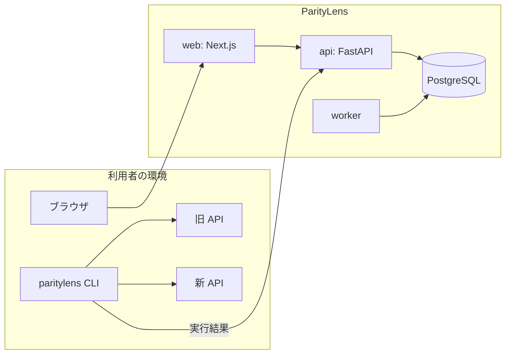

# ParityLens

API migration compatibility testing.

レガシー API を新しい API に置き換えるとき、「同じ入力に対して同じ挙動をするか」を検証するツール。旧 API と新 API に同じリクエストを送り、レスポンスの差異を検出して重大度を付ける。

> **開発状況**: Phase 2(比較エンジン)まで完了。エンジンはライブラリとして動き、デモ API に仕込んだ10個の差異をすべて検出する。リクエストを実行する CLI、Web の画面、AI による説明はまだない。進み具合は [Roadmap](#roadmap) を参照。

## Problem

API を書き直すと、誰も決めていない仕様変更が紛れ込む。

- 必須だった項目が、新しい DTO では任意になっている
- 端数処理の順序が変わり、特定の条件でだけ金額が 1 円ずれる
- 数値だったフィールドが文字列になっている
- エラー時のステータスコードが 400 から 422 に変わっている

新旧のレスポンスを JSON の diff にかければ違いは出る。しかし ID やタイムスタンプは毎回違うので、diff は常に差分だらけになり、本物の問題がその中に埋もれる。

## Solution

ParityLens は差異を3段階で絞り込む。

1. **ノイズを落とす。** 同じリクエストを旧 API に2回送り、その2回の間で変わった値は「実行ごとに変わる値」とみなして除外する。リクエスト時刻そのものを返しているタイムスタンプも除外する。設定は要らない
2. **決定的に分類する。** 残った差異を種類(ステータス変更、フィールド削除、型変更など)と重大度で分類する。ここまでは通常のアルゴリズムで、同じ入力からは必ず同じ結果が出る
3. **AI が説明する。** 分類済みの差異を LLM に渡し、なぜ問題になりうるかを説明させる。AI の見解は参考情報で、合否には影響しない

設計の全体は [MVP System Design](docs/architecture/mvp-system-design.md) にある。

## Architecture



比較のロジックは `packages/engine` という Python ライブラリにまとめ、CLI と worker の両方から使う。レガシー API はたいてい社内ネットワークにあるので、実行の主役は利用者の環境で動く CLI にした。理由は [ADR 0001](docs/adr/0001-engine-as-library-with-two-runners.md)。

## Tech Stack

| 領域 | 技術 |
|---|---|
| Frontend | Next.js (App Router), React, TypeScript, Tailwind CSS |
| Backend | Python, FastAPI, Pydantic |
| Database | PostgreSQL |
| テスト | pytest, Vitest, React Testing Library |
| 品質 | ruff, mypy (strict), ESLint, gitleaks |
| 実行環境 | Docker Compose, GitHub Actions |

## Demo

`demo/` に架空の注文 API が2つある。`modern-shop-api` は `legacy-shop-api` を書き直したもので、書き直しで起こりがちな差異を10個、意図的に入れてある。一覧は [demo/README.md](demo/README.md)。

たとえば 198 円と 105 円の商品を1つずつ注文すると、合計が 1 円違う。

```bash
BODY='{"customer_name":"John","items":[{"sku":"B-200","quantity":1},{"sku":"A-100","quantity":1}]}'
curl -s -X POST localhost:8001/orders -H 'content-type: application/json' -d "$BODY"   # "total": 332
curl -s -X POST localhost:8002/orders -H 'content-type: application/json' -d "$BODY"   # "total": 333
```

ParityLens の目標は、この10個を自動で見つけて正しい重大度を付けることである。

## Local Setup

必要なもの: Docker。

```bash
docker compose up --build
```

| URL | 内容 |
|---|---|
| http://localhost:3000 | Web |
| http://localhost:8000/docs | API(OpenAPI の画面) |
| http://localhost:8001/docs | Legacy Shop API |
| http://localhost:8002/docs | Modern Shop API |

設定を変えたい場合は `.env.example` を `.env` にコピーして編集する。コピーしなくても既定値で起動する。

### コンテナを使わずに開発する

必要なもの: [uv](https://docs.astral.sh/uv/)、Node.js 20.9 以上。Python 本体は uv が用意する。

```bash
uv sync                                               # Python の依存を入れる
uv run uvicorn paritylens_api.main:app --reload       # API  → :8000
uv run uvicorn legacy_shop_api.main:app --port 8001   # 旧デモ API
uv run uvicorn modern_shop_api.main:app --port 8002   # 新デモ API

cd apps/web && npm install && npm run dev             # Web  → :3000
```

## Testing

```bash
uv run pytest               # Python のテスト
uv run ruff check .         # lint
uv run ruff format --check . # フォーマットの確認
uv run mypy                 # 型検査(strict)

cd apps/web
npm test                    # Vitest
npm run lint
npm run typecheck
```

CI(GitHub Actions)では、上記に加えて `docker compose up` の起動確認と、gitleaks による秘密情報の検査を行う。

## Repository Structure

```
apps/
  api/             FastAPI(API と worker)
  web/             Next.js
packages/
  engine/          比較エンジン。Web にも DB にも依存しない
demo/
  legacy-shop-api/ 旧 API(架空)
  modern-shop-api/ 新 API(架空、差異を仕込んである)
docs/
  architecture/    設計書
  adr/             設計判断の記録
  learning/        学習メモ
infra/docker/      Dockerfile
```

## Technical Decisions

| ADR | 判断 |
|---|---|
| [0001](docs/adr/0001-engine-as-library-with-two-runners.md) | engine をライブラリとして分離し、実行形態を2つ持つ |
| [0002](docs/adr/0002-use-fastapi.md) | バックエンドに FastAPI を使う |
| [0003](docs/adr/0003-use-postgresql.md) | PostgreSQL を使い、ジョブキューも当面 PostgreSQL で持つ |
| [0004](docs/adr/0004-separate-deterministic-and-ai-diff.md) | 決定的 diff と AI 分析を分離する |
| [0005](docs/adr/0005-noise-detection.md) | ノイズの検出に、2回実行とリクエスト時刻への追従を使う |

## Security

- デモ API は架空のもので、実在のシステムの仕様・コード・データは含まない
- `.env` はコミットしない。pre-commit と CI で gitleaks を実行する
- ParityLens は対象の API にリクエストを送り、レスポンスを保存する。本番環境や本番データに対して使うことは想定していない

外向き通信の制御(SSRF 対策)、認証、秘密情報の扱いは [設計書の 12・13 章](docs/architecture/mvp-system-design.md#12-authentication) にまとめてある。実装は Phase 3 と Phase 4 で行う。

## Roadmap

| Phase | 内容 | 状態 |
|---|---|---|
| 1 | Project Setup: モノレポ、Docker Compose、CI、デモ API | 完了 |
| 2 | Deterministic Diff: 正規化、差異の分類、ノイズ検出、重大度 | 完了 |
| 3 | Execution + CLI: `paritylens run` | 未着手 |
| 4 | Database + API: 認証、CRUD、hosted 実行 | 未着手 |
| 5 | Dashboard | 未着手 |
| 6 | AI Semantic Analysis | 未着手 |
| 7 | Deployment(AWS) | 未着手 |

MVP のあとの計画(仕様書 RAG、テストケース生成、GitHub 連携など)は設計書の 17 章にある。
