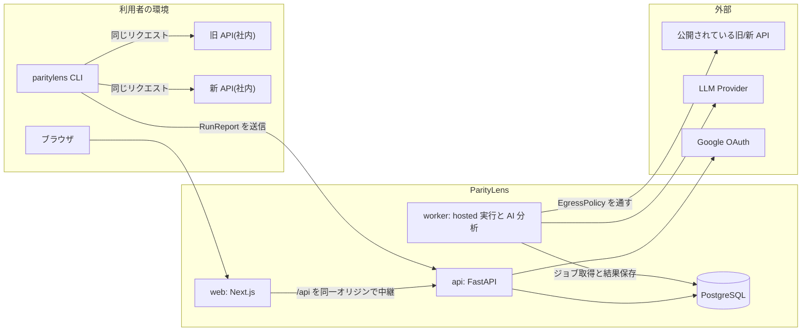
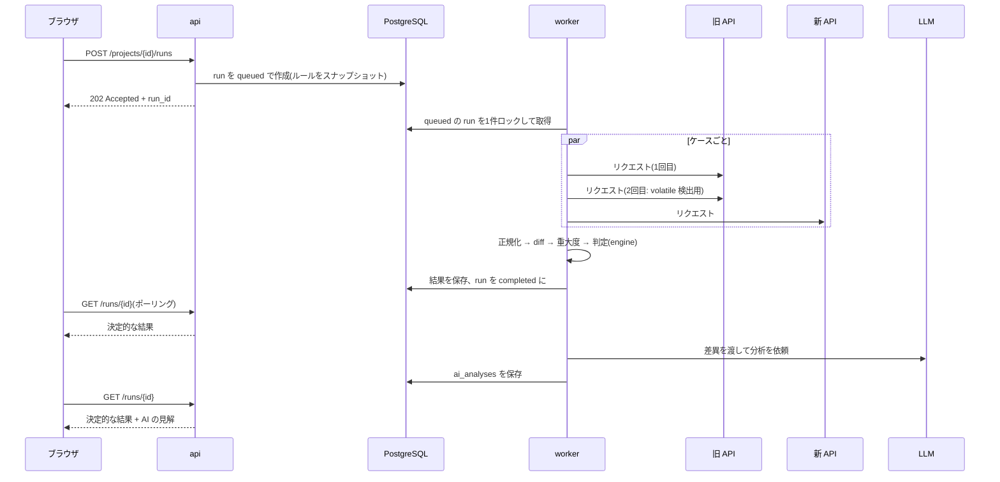
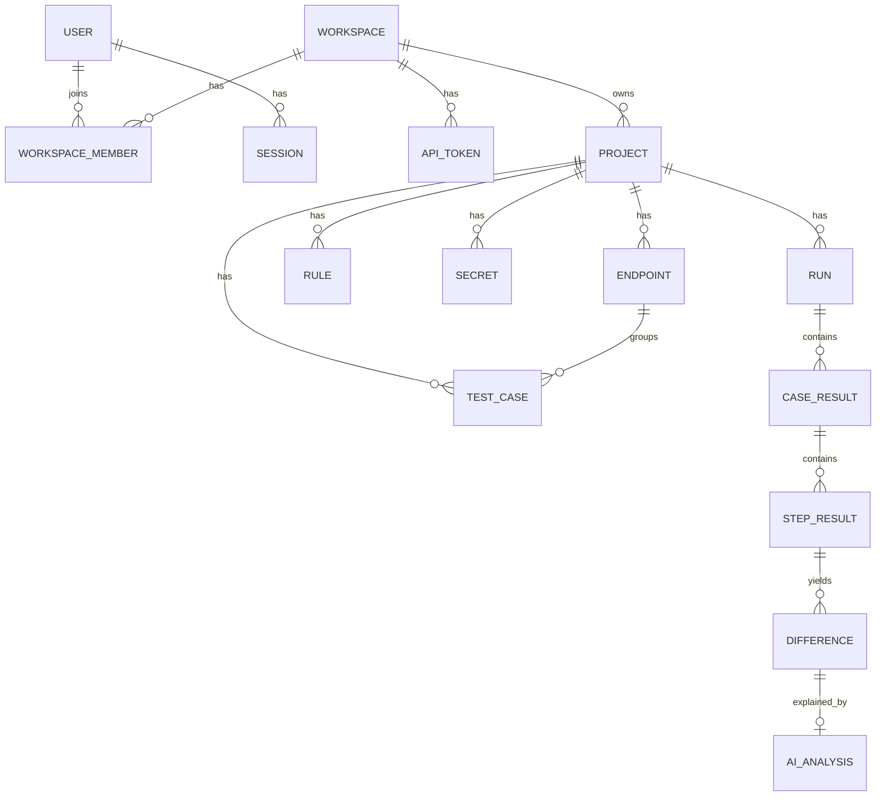
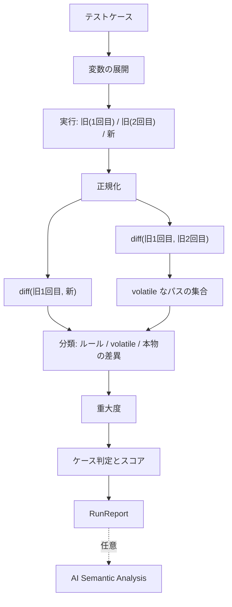
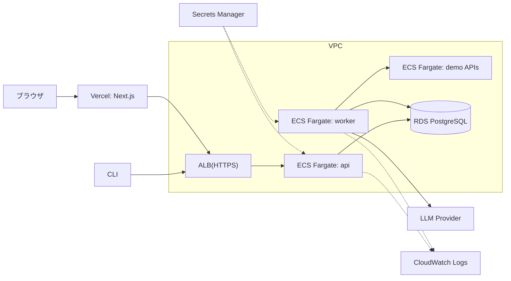

# ParityLens MVP System Design

- 状態: Draft(実装前)
- 最終更新: 2026-10-02(Phase 1 完了時点)
- 対象: MVP(v0.1)。それ以降は「20. Future scalability」と Roadmap を参照

ParityLens は、レガシー API を新 API に置き換えるときに「同じ入力に対して同じ挙動をするか」を検証するツールである。旧 API と新 API に同じリクエストを送り、差異を決定的なアルゴリズムで検出・分類し、そのうえで LLM が「その差異が意味的に重要か」を補助的に説明する。

この文書で使う用語を先に定義する。

| 用語 | 意味 |
|---|---|
| engine | 正規化・差分・重大度判定・HTTP 実行を持つ Python ライブラリ。DB も Web も知らない |
| runner | engine を使ってテストを実行する主体。CLI(利用者の環境で動く)と worker(ParityLens 側で動く)の2種類 |
| hosted 実行 | ParityLens のサーバー(worker)が旧/新 API を叩く実行形態 |
| RunReport | 1回の実行結果を表す JSON。CLI と worker が同じ形式で出力する |
| volatile | 同じ API を2回叩いただけで変わる値(ID、タイムスタンプなど)。互換性の問題ではない |
| 決定的 | 同じ入力とルールなら必ず同じ結果になること。LLM を含まない |

---

## 1. Product requirements

### 想定ユーザーと課題

レガシー API の刷新を担当するエンジニア。次の4つに時間を取られている。

1. 新旧の挙動が一致しているかを、手作業のレスポンス見比べで確認している
2. 差分のうち、ノイズ(ID・時刻)と本物の不具合を仕分けるのに手間がかかる
3. 「この差は問題か」の判断根拠がレビューで共有しにくい
4. リプレイス後のデグレを CI で止める仕組みがない

### 機能要件

| ID | 要件 |
|---|---|
| FR1 | Migration Project を作り、旧/新 API の Base URL を登録できる |
| FR2 | Endpoint を手動登録、または OpenAPI から取り込める |
| FR3 | テストケース(1つ以上のステップからなるシナリオ)を作成できる |
| FR4 | 同じテストケースを旧/新の両方に実行し、ステータス・ボディ・ヘッダー・応答時間を記録できる |
| FR5 | volatile な値を自動検出し、互換性の問題から除外できる |
| FR6 | 利用者が比較ルール(無視・順不同・重要フィールド)を設定できる |
| FR7 | 差異を種類と重大度で決定的に分類できる |
| FR8 | LLM が差異ごとに Safe / Warning / Breaking の見解と理由を出す。決定的な結果とは別に保存・表示する |
| FR9 | 実行結果(互換性スコア、差異一覧、新旧の並列表示)をダッシュボードで見られる |
| FR10 | CLI で実行でき、重大な差異があれば非ゼロで終了する |

### 非機能要件

| 項目 | 要件 |
|---|---|
| 再現性 | 実行時のルールと engine のバージョンを結果に保存する。同じレスポンスとルールからは同じ差異が出る |
| テナント分離 | すべてのリソースは workspace に属する。他 workspace の ID を指定しても 404 を返す |
| 秘密情報 | 対象 API の認証情報は暗号化して保存し、API からもログからも読み出せない |
| AI の位置づけ | AI が無効でも失敗しても、決定的な結果はすべて得られる |
| 安全な外向き通信 | hosted 実行は SSRF 対策を通った宛先にしか接続しない |

---

## 2. MVP scope

MVP の完成条件は次のデモが通ること。

> `docker compose up` で起動し、デモ用の旧/新 Shop API を登録して実行すると、仕込んである差異(検証ロジックの変更、金額計算のずれ、型変更など)が正しい重大度で表示され、ID やタイムスタンプは Safe differences に分類され、LLM の説明が付く。

含めるもの:

- Project / Endpoint / TestCase / Rule の CRUD(Web)
- OpenAPI からの Endpoint 取り込み(パスとメソッドの一覧化だけ)
- engine: 正規化、決定的 diff、volatile 自動検出、重大度、判定
- 実行形態 2つ: CLI(`paritylens run`)と hosted 実行(worker)
- CLI からの結果アップロード
- ダッシュボード: 実行一覧、Compatibility Result、ケース詳細(新旧並列)
- AI Semantic Analysis(プロバイダー1社 + テスト用 Fake)
- 認証(Google OAuth + ローカル用の開発ログイン)、API トークン
- デモ用 API 2つ、AWS へのデプロイ

---

## 3. Out of scope

| 項目 | 扱い |
|---|---|
| 仕様書 RAG、Evidence 表示 | Roadmap R1 |
| OpenAPI からの AI テスト生成 | Roadmap R2 |
| 数百件以上の並列実行、SQS | Roadmap R3 |
| GitHub App / PR 連携 | Roadmap R4 |
| Shadow Traffic | Roadmap R6。本番トラフィックを扱うため最後 |
| workspace への招待、ロール | テーブルだけ用意し、UI は作らない |
| 応答時間の比較判定 | 記録と表示のみ。1回の計測では判定に使えない |
| JSON 以外のボディの構造比較(XML、HTML) | テキストの完全一致だけ |
| ヘッダーの網羅比較 | `content-type` と、利用者が指定したヘッダーだけ |
| HAR / curl からの取り込み | MVP 直後(v0.2)。データモデルは対応済みにしておく |
| 2社目の LLM プロバイダー実装 | インターフェースだけ切り、実装は1社 |
| 対象ドメインの所有確認 | 公開環境の hosted 実行は許可リスト方式で代替する |

---

## 4. System architecture

### 中心になる設計判断

**engine を純粋なライブラリとして切り出し、実行する場所を2つ用意する。**

レガシー API はたいてい社内ネットワークにあり、外部の SaaS からは届かない。そこで実行の主役は利用者の環境で動く CLI とし、ParityLens のサーバーは結果の保存・可視化・AI 分析を担当する。ブラウザから「実行」を押せる hosted 実行も用意するが、これは同じ engine を worker から呼ぶだけの薄い層である。

CLI と worker はどちらも `RunReport` を出力し、API は1つの関数でそれを保存する。実行形態が2つあっても、保存以降の経路は1本になる。



`cli` と `worker` はどちらも `packages/engine` を import して使う。

### hosted 実行の流れ



決定的な結果は AI 分析を待たずに表示できる。AI が失敗しても run は completed のまま。

---

## 5. Frontend architecture

Next.js(App Router)+ TypeScript + Tailwind CSS + shadcn/ui。

### 画面

| パス | 内容 |
|---|---|
| `/login` | Google ログイン(ローカルは開発ログイン) |
| `/projects` | プロジェクト一覧 |
| `/projects/[projectId]` | 概要: 最新の互換性スコア、Endpoint ごとの状況 |
| `/projects/[projectId]/endpoints` | Endpoint 一覧、手動登録、OpenAPI 取り込み |
| `/projects/[projectId]/test-cases` | テストケース一覧 |
| `/projects/[projectId]/test-cases/[id]` | テストケース編集(ステップ、リクエスト、capture) |
| `/projects/[projectId]/rules` | 比較ルール |
| `/projects/[projectId]/settings` | Base URL、シークレット、AI 分析の有効化 |
| `/projects/[projectId]/runs` | 実行履歴 |
| `/runs/[runId]` | Compatibility Result |
| `/runs/[runId]/cases/[caseResultId]` | ケース詳細: 新旧レスポンスの並列表示、差異、AI の説明 |
| `/settings/tokens` | CLI 用 API トークン |

### 方針

- **読み取りは Server Component、操作は Client Component。** 一覧や詳細の初期表示はサーバー側で API を呼んで HTML にする。フォーム、diff ビューア、実行状況のポーリングなど、状態やイベントを持つ部分だけを Client Component にする
- **更新は Client Component から API を直接呼ぶ**(TanStack Query の mutation)。Server Actions は使わない。更新経路を1種類に絞り、バックエンドの API を唯一の入口にするため
- **型は FastAPI の OpenAPI から生成する**(`openapi-typescript` + `openapi-fetch`)。手書きの共有型パッケージは持たない
- フォームは React Hook Form + Zod。Zod は入力時の検証用で、正は API 側の Pydantic
- ブラウザからの API 呼び出しは Next.js の rewrites で `/api/*` を FastAPI に中継する。同一オリジンになるので CORS 設定が不要になり、セッション Cookie も素直に扱える
- 認可は API が行う。Next.js 側の Proxy(Next.js 16 で Middleware から改名)は、未ログイン時に `/login` へ送るだけ

### 差異の表示

Compatibility Result は次の3ブロックで構成する。決定的な重大度と AI の見解は別のバッジで並べて表示し、混ぜない。

1. スコア: `94%(47 / 50 ケース)`。分母を必ず併記する
2. Potential Breaking Changes: 重大度 MEDIUM 以上。重大度順
3. Safe differences: 重大度 NONE にしたフィールドと、その根拠(`ignore` ルール / 2回実行での変動)

---

## 6. Backend architecture

Python + FastAPI + Pydantic v2 + SQLAlchemy 2.0(async)+ Alembic + httpx。

### レイヤー

```
apps/api/src/paritylens_api/
├─ main.py            アプリ生成、ミドルウェア、ルーター登録
├─ core/              設定、ログ、暗号化、例外
├─ deps.py            Depends: DB セッション、現在のユーザー、workspace
├─ routers/           HTTP 層(入出力の変換と認可の入口)
├─ schemas/           リクエスト/レスポンスの Pydantic モデル
├─ services/          ロジックがある処理(run の作成・保存、取り込み、AI 分析)
├─ repositories/      DB アクセス。すべての関数が workspace_id を引数に取る
├─ models/            SQLAlchemy の ORM モデル
├─ ai/                LLMProvider、プロンプト、分析の検証
└─ worker/            ジョブ取得ループ(run 実行、AI 分析)
```

- 単純な CRUD は router から repository を直接呼ぶ。service を挟むのはロジックがあるときだけ
- repository は `workspace_id` なしでは呼べない形にする。テナント分離を書き忘れにくくするため
- worker は api と同じイメージを別コマンドで起動する。`runs` テーブルをキューとして使い、`SELECT ... FOR UPDATE SKIP LOCKED` で1件ずつ取得する。SQS に移行するときは取得部分だけを差し替える
- エラー応答は RFC 9457(Problem Details)に統一する

### engine の構成

```
packages/engine/src/paritylens_engine/
├─ model.py           Suite, Case, Step, Exchange, Difference, RunReport
├─ template.py        {{変数}} の展開、capture
├─ egress.py          EgressPolicy(接続先の検証)
├─ executor.py        httpx による実行。engine で唯一の I/O
├─ normalize.py       ボディ・ヘッダーの正規化
├─ paths.py           パス式(JSONPath のサブセット)の照合
├─ diff.py            決定的 diff
├─ noise.py           volatile 検出
├─ severity.py        重大度ルール
├─ verdict.py         ケース判定、スコア
└─ report.py          RunReport の組み立て
```

`executor.py` 以外は I/O を持たない純粋関数にする。テストで HTTP も DB も要らない。

HTTP クライアントは Phase 3 の着手時に、httpx と後継の httpx2 を比べて決める。Phase 1 の時点で、Starlette のテストクライアントが httpx を非推奨にして httpx2 を求めるようになっている。

---

## 7. Database schema

PostgreSQL。主キーは UUID(連番にしない)。全テーブルに `created_at`、更新があるテーブルに `updated_at`。



| テーブル | 主な列 | 補足 |
|---|---|---|
| `users` | email, name, google_sub | |
| `workspaces` | name | 初回ログイン時に個人用を1つ作る |
| `workspace_members` | workspace_id, user_id, role | MVP では role は owner だけ |
| `sessions` | user_id, token_hash, expires_at | トークン本体は保存しない |
| `api_tokens` | workspace_id, user_id, name, token_hash, last_used_at, revoked_at | CLI 用 |
| `projects` | workspace_id, name, old_base_url, new_base_url, openapi_spec(JSONB), ai_enabled | |
| `endpoints` | project_id, method, path_template, summary, source | unique(project_id, method, path_template) |
| `rules` | project_id, endpoint_id(null 可), kind, path, options(JSONB) | kind: ignore / unordered / critical |
| `secrets` | project_id, name, ciphertext, nonce, key_version | 値は書き込み専用 |
| `test_cases` | project_id, endpoint_id(null 可), name, steps(JSONB), noise_detection, enabled | steps は Pydantic で検証 |
| `runs` | project_id, source(hosted/cli), status, ai_status, old_base_url, new_base_url, rules_snapshot(JSONB), summary(JSONB), engine_version, started_at, finished_at | 実行時点の設定を保存 |
| `case_results` | run_id, test_case_id(null 可), case_name, verdict, max_severity, error | テストケースを消しても結果は残す |
| `step_results` | case_result_id, step_index, request(JSONB), old_response(JSONB), new_response(JSONB), volatile_paths(JSONB) | レスポンスは上限サイズで切り詰める |
| `differences` | step_result_id, run_id, kind, path, old_value(JSONB), new_value(JSONB), severity, noise_source, signature | signature は同種の差異をまとめるためのハッシュ |
| `ai_analyses` | difference_id(unique), verdict, confidence, explanation, provider, model, prompt_version | |

判断したこと:

- **テストケースの定義は JSONB、実行結果は正規化したテーブル。** 定義は CLI の YAML と同じ形のドキュメントとして扱う。結果は重大度や種類で絞り込むので列にする
- **`workspace_id` は `projects` にだけ持つ。** 子テーブルは必ず project 経由で参照する。真実が1か所になる代わりに JOIN が増える
- **実行結果は不変。** 再実行は新しい run を作る

---

## 8. API design

REST、プレフィックスは `/api/v1`。認証はブラウザがセッション Cookie、CLI が `Authorization: Bearer plk_...`。

| メソッド | パス | 内容 |
|---|---|---|
| GET | `/auth/google/login`, `/auth/google/callback` | OAuth |
| POST | `/auth/logout` | |
| GET | `/me` | ユーザーと workspace |
| GET, POST | `/api-tokens` | 作成時だけ平文を返す |
| DELETE | `/api-tokens/{id}` | |
| GET, POST | `/projects` | |
| GET, PATCH, DELETE | `/projects/{id}` | |
| POST | `/projects/{id}/openapi` | OpenAPI を保存し Endpoint を取り込む |
| GET, POST | `/projects/{id}/endpoints` | |
| PATCH, DELETE | `/endpoints/{id}` | |
| GET, POST | `/projects/{id}/rules` | |
| DELETE | `/rules/{id}` | |
| GET | `/projects/{id}/secrets` | 名前と更新日時だけ返す |
| PUT, DELETE | `/projects/{id}/secrets/{name}` | |
| GET, POST | `/projects/{id}/test-cases` | |
| GET, PATCH, DELETE | `/test-cases/{id}` | |
| POST | `/projects/{id}/runs` | hosted 実行を依頼。202 を返す |
| POST | `/projects/{id}/runs/import` | CLI が RunReport を送る |
| GET | `/projects/{id}/runs` | |
| GET | `/runs/{id}` | 概要、スコア、状態 |
| GET | `/runs/{id}/differences` | 重大度・種類で絞り込み |
| GET | `/case-results/{id}` | ステップ、新旧レスポンス、差異、AI の見解 |
| POST | `/runs/{id}/analysis` | AI 分析のやり直し |

- 一覧はカーソル方式のページング
- 他 workspace のリソースは 403 ではなく 404。存在を知らせない
- `RunReport` には `schema_version` を持たせ、古い CLI からの送信を判別する

---

## 9. Differential Testing architecture

### パイプライン



実線の範囲はすべて決定的。AI は RunReport が確定したあとに、別の工程として動く。

### テストケースの形

CLI 用の YAML と DB の `steps` は同じ構造にする。

```yaml
version: 1
targets:
  old: { base_url: http://localhost:8001 }
  new: { base_url: http://localhost:8002 }
defaults:
  headers:
    Authorization: "Bearer ${SHOP_API_TOKEN}"   # 環境変数から解決。送信も保存もしない
rules:
  - ignore: "$..request_id"
  - unordered: "$.items"
    key: sku
  - critical: "$..total"
cases:
  - name: 注文を作成して取得する
    steps:
      - id: create
        request:
          method: POST
          path: /orders
          json: { customer_name: John, items: [{ sku: A-1, quantity: 3 }] }
        capture:
          order_id: "$.id"
      - id: fetch
        request:
          method: GET
          path: /orders/{{order_id}}
```

- ステップは順番に実行する。条件分岐とループは持たない
- `capture` で取り出した値は側(旧/新)ごとに別の変数として持つ。旧が返した ID で旧に、新が返した ID で新に問い合わせる
- ある側で capture に失敗したら、その側の後続ステップは実行せず `skipped` として記録する

### 実行

- 旧(1回目)・旧(2回目)・新の3系統は並行に実行する。ケース間の並行数には上限を設ける(既定 4)
- 接続タイムアウト 5 秒、全体 30 秒。レスポンスは 1 MiB で打ち切り、打ち切った場合はボディ比較をせずにその旨を記録する
- リダイレクトは追わない。3xx はそのままレスポンスとして比較する
- 1ケース最大 20 ステップ、1回の実行で最大 500 ケース

### 差異の種類

| kind | 意味 |
|---|---|
| `STATUS_CHANGED` | HTTP ステータスが違う |
| `BODY_FORMAT_CHANGED` | Content-Type のメディアタイプが違う、または片方だけ JSON として読めない |
| `HEADER_CHANGED` | 比較対象のヘッダーが違う |
| `FIELD_ADDED` | 新にだけフィールドがある |
| `FIELD_REMOVED` | 旧にだけフィールドがある。`null` と「存在しない」は区別する |
| `TYPE_CHANGED` | JSON の型が違う(`"100"` と `100` など) |
| `VALUE_CHANGED` | 型は同じで値が違う |
| `ARRAY_CHANGED` | 配列の長さ、または要素の対応が違う |

ステータスのクラス(2xx / 4xx など)が新旧で違う場合、ボディは比較しない。成功レスポンスとエラーレスポンスを項目ごとに比べても、`STATUS_CHANGED` 1件で言えることを大量の `FIELD_REMOVED` で繰り返すだけになる。同じクラス内の違い(200 と 201 など)ではボディも比較する。

### 重大度(決定的なルール)

| 条件 | 重大度 |
|---|---|
| `ignore` ルールに一致(種類を問わない)、または volatile なパスでの `VALUE_CHANGED` | NONE |
| `FIELD_ADDED`、`HEADER_CHANGED` | LOW |
| `VALUE_CHANGED`、`ARRAY_CHANGED` | MEDIUM |
| `FIELD_REMOVED`、`TYPE_CHANGED`、`BODY_FORMAT_CHANGED` | HIGH |
| `STATUS_CHANGED`(同じクラス内。200 → 201 など) | HIGH |
| `STATUS_CHANGED`(成功と失敗が入れ替わる。400 → 200 など) | CRITICAL |
| 重要フィールドでの `VALUE_CHANGED` / `TYPE_CHANGED` / `FIELD_REMOVED` | CRITICAL |

重要フィールドは `critical` ルールで明示するほか、フィールド名による既定の推定を持つ(`amount`, `balance`, `price`, `total`, `tax`, `fee` など)。推定で CRITICAL にした場合は、画面にその根拠を出す。

### ケース判定とスコア

| verdict | 条件 |
|---|---|
| `error` | どちらかの側で実行に失敗(接続エラー、タイムアウト) |
| `breaking` | 最大の重大度が HIGH 以上 |
| `warning` | 最大の重大度が MEDIUM |
| `compatible` | 最大の重大度が LOW 以下 |

互換性スコア = `compatible` のケース数 ÷(全ケース数 − `error` のケース数)。

スコアが示すのは「実行したテストケースのうち何割が互換だったか」であり、API 全体の互換性ではない。画面でも CLI でも分母を併記する。CLI は既定で HIGH 以上の差異が1つでもあれば終了コード 1 を返す(`--fail-on` で変更可)。

---

## 10. Normalization design

比較の前に、レスポンスを比較可能な形に揃える。

1. **ボディ**: Content-Type が JSON なら木構造に変換する。数値は `Decimal` として読み、浮動小数点の誤差で金額がずれないようにする。JSON 以外はテキストのまま扱う
2. **ヘッダー**: 名前を小文字にそろえ、比較対象(`content-type` のメディアタイプと、利用者が指定したもの)だけを残す
3. **ルールの適用**: 下の3種類

| ルール | 例 | 効果 |
|---|---|---|
| `ignore` | `$.created_at`、`$..request_id` | そのパスを比較から外す |
| `unordered` | `$.items`(任意で `key: sku`) | 配列を順不同として比較する。key があれば key で要素を対応づける |
| `critical` | `$..total` | そのパスの差異を CRITICAL にする |

パス式は JSONPath のサブセット(`$.a.b`、`[0]`、`[*]`、`..name`)に限定し、自前で実装する。差異の表示にも同じ記法を使い、差異の画面から「このパスを無視する」をそのままルールにできるようにする。

### volatile の自動検出

同じリクエストを旧 API に2回送り、その2つのレスポンスの間で値が変わったパスを volatile とみなす。Twitter の Diffy が採った考え方で、検出に diff エンジンをそのまま再利用できる。

- diff(旧1回目, 旧2回目)に現れたパスを集める。配列の添字は `[*]` に置き換えて一般化する
- diff(旧1回目, 新)のうち、そのパスに一致する `VALUE_CHANGED` を `noise_source = baseline` として NONE にする
- 抑制するのは `VALUE_CHANGED` だけ。volatile なパスでも `TYPE_CHANGED` や `FIELD_REMOVED` は残す。ID が数値から文字列に変わった、というような差異を「毎回変わる値だから」と見逃さないため
- 旧1回目と旧2回目でステータスが違う場合は、そのケースを「基準が不安定」として警告する

値のパターン(UUID、ISO 8601 の日時)による推定も持つが、これは2回実行を無効にしたときの代替で、「volatile の可能性」として表示するだけにする。差異は隠さない。

根拠の優先順位は 利用者のルール > 2回実行での観測 > 値のパターン。

この方式の利点は、形が日時でも値が安定しているフィールドを見逃さないこと。たとえば固定の注文データの `ordered_at` が旧新で9時間ずれている場合、2回実行では変動しないので本物の差異として残る。

制約もある。POST のような副作用のあるリクエストを旧 API に2回送ることになるため、テスト環境での利用を前提とし、ケース単位で無効にできるようにする(18章)。

---

## 11. Semantic Diff design

### 原則

- LLM に渡すのは決定的 diff の結果であり、LLM が差異を見つけるのではない
- LLM の出力は `ai_analyses` に別保存する。`differences.severity` を書き換えない
- CI の合否は決定的な重大度だけで決まる

### 入出力

入力(run 単位でまとめる):

- Endpoint、リクエストの概要(秘密情報は除去済み)
- 重大度 LOW 以上の差異: ID、kind、パス、新旧の値(長い値は切り詰め)、決定的な重大度
- 同じ signature(Endpoint + kind + 一般化したパス)の差異は1件に集約して渡す

出力(構造化出力を Pydantic で検証):

| フィールド | 内容 |
|---|---|
| `difference_id` | 入力にあった ID。存在しない ID が返ってきたら破棄する |
| `verdict` | `safe` / `warning` / `breaking` |
| `confidence` | `low` / `medium` / `high` |
| `explanation` | なぜ問題になりうるか、または問題にならないか |

### プロバイダー抽象

```python
class LLMProvider(Protocol):
    async def complete_structured(
        self, *, system: str, user: str, schema: type[BaseModel]
    ) -> BaseModel: ...
```

実装は `AnthropicProvider` と、テスト用の `FakeProvider`。モデルは環境変数で指定する。分析ロジック(`ai/analyzer.py`)は `LLMProvider` にだけ依存し、SDK を直接 import しない。プロンプトにはバージョンを付け、結果と一緒に保存する。

### 画面での扱い

決定的な重大度と AI の見解が食い違うことがある(例: 決定的には HIGH、AI は safe)。その場合も重大度は変えず、両方を並べて表示する。利用者が納得したら、明示的にルールを追加して次回から除外する。AI の判断を、人が承認した決定的なルールに変換する流れにする。

### AI を使わない条件

- プロジェクトの `ai_enabled` が false(既定)
- 差異が volatile とルールで無視したものだけ
- プロバイダーの API キーが未設定

---

## 12. Authentication

**認証は FastAPI が持つ。**

- Google OAuth(OIDC)を Authlib で実装する。コールバックでユーザーを作成または取得し、セッションを発行する
- セッションはランダムなトークン。ブラウザには `HttpOnly; Secure; SameSite=Lax` の Cookie で渡し、DB にはハッシュだけを保存する
- CLI は API トークン(`plk_` で始まるランダム文字列)。DB にはハッシュだけを保存し、平文は作成時に1回だけ表示する
- CSRF 対策: `SameSite=Lax` に加えて、更新系リクエストでは `Origin` ヘッダーを検証する
- ローカル用に開発ログインを用意する(`AUTH_MODE=dev`)。Google の設定なしで `docker compose up` だけで試せるようにするため。本番環境の設定でこのモードが有効ならアプリは起動を拒否する

Auth.js(NextAuth)を使わない理由: セッションを Next.js が持つと、FastAPI 側でそれを検証する仕組みが別に必要になる。CLI のトークン認証も API 側に要るので、認証を1か所にまとめた。

### 認可

- `Depends` で「現在のユーザー」と「その workspace」を解決し、repository に渡す
- 全リソースについて「他 workspace の ID を指定したら 404」をテストで確認する(16章)

---

## 13. Security / SSRF protection

### 脅威と前提

hosted 実行では、利用者が登録した URL に ParityLens のサーバーが接続する。攻撃者は URL を使って、内部ネットワークやクラウドのメタデータエンドポイントを読ませようとする。

CLI 実行にはこの問題がない。利用者自身のマシンから、利用者が到達できる宛先に接続するだけだからである。

### EgressPolicy

接続先の検証を `EgressPolicy` として engine に持ち、実行形態ごとに切り替える。

| ポリシー | 使う場所 | 内容 |
|---|---|---|
| `allowlist` | 公開デモ環境の worker | 設定したホスト(デモ API)にしか接続しない |
| `public_only` | 一般公開する SaaS の worker | グローバルに到達可能なアドレスだけ許可する |
| `permissive` | CLI、ローカル開発 | プライベートアドレスを許可する。メタデータエンドポイントは拒否する |

### `public_only` の検証内容

| 対策 | 内容 |
|---|---|
| スキーム | `http` と `https` だけ。URL 内のユーザー情報(`user:pass@`)は拒否 |
| ポート | 80 と 443 だけ(設定で追加可) |
| アドレス検証 | 名前解決した**すべての** IP を検査する。ループバック、プライベート(RFC 1918)、リンクローカル(`169.254.0.0/16`、メタデータを含む)、CGNAT、IPv6 の ULA とリンクローカル、マルチキャスト、予約済みを拒否。IPv4-mapped IPv6 は IPv4 に戻してから判定する |
| DNS rebinding | 検証した IP に対して接続する。検証と接続の間で名前解決をやり直さない。Host ヘッダーと TLS の SNI は元のホスト名を使う |
| リダイレクト | 追わない。3xx はレスポンスとして記録するだけ |
| 環境変数 | `trust_env=False`。プロキシ設定や `.netrc` を拾わない |
| 資源の上限 | タイムアウト、レスポンスサイズ上限、1回の実行のリクエスト数上限、workspace ごとの同時実行数 |

DNS rebinding 対策は、httpx の下層(httpcore)の接続処理を差し替えて、名前解決・検証・接続を1か所で行う形で実装する。この部分は実装前に小さな検証コードで成立を確かめる(18章)。

### インフラ側の多層防御

- worker のセキュリティグループは外向き 80/443 と DB への接続だけを許可する
- worker のタスクロールには AWS の権限をほとんど与えない
- 公開デモ環境は `allowlist` で運用する。任意の URL を叩ける公開サービスは、第三者への攻撃の踏み台になりうる。`public_only` を一般に開放するのは、対象ドメインの所有確認を実装してからにする

### 秘密情報

- 対象 API の認証情報は `secrets` に AES-256-GCM で暗号化して保存する。マスターキーは環境変数(本番は Secrets Manager)から読み、`key_version` でローテーションに備える
- API はシークレットの値を返さない。返すのは名前と更新日時だけ
- テストケースからは `{{secret.NAME}}` で参照し、実行の直前に展開する
- CLI では環境変数(`${VAR}`)から読む。値はサーバーに送らない
- 保存・送信する RunReport では、`authorization`、`cookie`、`set-cookie`、`x-api-key` などのヘッダー値を伏せ字にする

### ログ

| 残す | 残さない |
|---|---|
| run / case / step の ID、側(旧/新)、ホスト名、パス(クエリ文字列は除く)、ステータス、所要時間、エラーの種類、AI 分析のモデルとトークン数 | リクエスト/レスポンスのボディ、認証系ヘッダー、シークレットの値、クエリ文字列、メールアドレス |

構造化ログ(JSON)で出力し、出力の直前に伏せ字処理を通す。「シークレットを使って実行してもログにその値が現れない」ことをテストで確認する。

### 保存するレスポンス

レスポンスのボディは表示のために DB に保存する。個人情報を含みうるので、サイズ上限、保存期間(既定 30 日)を設け、README に「本番データを流さない」と明記する。

### 公開リポジトリ

- `.env` はコミットしない。`.env.example` だけを管理する
- pre-commit と CI で gitleaks を実行する
- デモは架空の Shop API だけを使う。実在のシステムの仕様・コード・データは入れない

---

## 14. AWS architecture



| 要素 | 選択 | 理由 |
|---|---|---|
| Frontend | Vercel | Next.js の運用を任せ、AWS 側の学習を API と DB に集中する |
| Backend | ECS Fargate(api と worker を別サービス) | 同じイメージ、別コマンド |
| DB | RDS PostgreSQL(小さいインスタンス1台) | 将来 pgvector を足す |
| 秘密情報 | Secrets Manager | DB 接続情報、マスターキー、LLM の API キー |
| ログ | CloudWatch Logs | |
| IaC | Terraform | `infra/terraform/` に置く |
| CI/CD | GitHub Actions + OIDC | 長期のアクセスキーを GitHub に置かない |

費用を抑えるため、MVP では NAT Gateway を置かず、Fargate のタスクをパブリックサブネットに配置してセキュリティグループで入口を閉じる。プライベートサブネット + NAT のほうが堅いが、固定費が月数千円増える。この判断は ADR に残す。

MVP で使わないもの: SQS、S3、CloudFront。

---

## 15. Repository structure

```
paritylens/
├─ apps/
│  ├─ web/                    Next.js
│  └─ api/                    FastAPI(api と worker)
├─ packages/
│  ├─ engine/                 比較エンジン(純粋な Python ライブラリ)
│  └─ cli/                    paritylens コマンド
├─ demo/
│  ├─ legacy-shop-api/        旧 API(架空)
│  ├─ modern-shop-api/        新 API(架空、差異を仕込む)
│  └─ suite.yaml              デモ用テストスイート
├─ docs/
│  ├─ architecture/           この文書、図
│  ├─ adr/                    Architecture Decision Records
│  └─ learning/               学習メモ
├─ infra/
│  ├─ docker/
│  └─ terraform/
├─ .github/workflows/
├─ docker-compose.yml
├─ .env.example
├─ pyproject.toml             uv workspace のルート
└─ README.md
```

- Python は uv の workspace で `apps/api`、`packages/*`、`demo/*` をまとめる
- JavaScript は `apps/web` だけなので、JS 側の workspace は作らない。パッケージマネージャーは npm
- `packages/cli` は Phase 3 で追加する
- 依頼時の案にあった `packages/shared` は作らない。型は OpenAPI から生成する

### ツール

| 用途 | Python | TypeScript |
|---|---|---|
| Lint / Format | ruff | ESLint、Prettier |
| 型検査 | mypy(strict) | tsc(strict) |
| テスト | pytest、Hypothesis | Vitest、React Testing Library、Playwright |

### 予定している ADR

| 番号 | 題 |
|---|---|
| 0001 | engine をライブラリとして分離し、CLI と hosted の2つの実行形態を持つ |
| 0002 | バックエンドに FastAPI を使う |
| 0003 | PostgreSQL を使い、ジョブキューも当面 PostgreSQL で持つ |
| 0004 | 決定的 diff と AI 分析を分離する |
| 0005 | volatile の検出に2回実行を使う |
| 0006 | LLM プロバイダーを抽象化する |
| 0007 | 外向き通信の制御(EgressPolicy) |
| 0008 | 認証をバックエンドで持つ |
| 0009 | フロントエンドの型を OpenAPI から生成する |
| 0010 | AWS 構成と費用の判断 |

### デモ API に仕込む差異

| # | 内容 | 期待する検出 |
|---|---|---|
| 1 | 新規注文の `id` の形式が違う、`created_at` が実行ごとに変わる | NONE(volatile) |
| 2 | 新にだけ `currency` フィールドがある | `FIELD_ADDED` / LOW |
| 3 | `customer_name` がないとき、旧は 400、新は 201 | `STATUS_CHANGED` / CRITICAL |
| 4 | 消費税の端数処理が違う(旧は明細ごと、新は注文合計に対して切り捨て)。明細が複数あると合計が 1 円ずれることがある | `VALUE_CHANGED` / CRITICAL |
| 5 | 取り消しの応答が旧は 200 + ボディ、新は 204 でボディなし | `STATUS_CHANGED` / HIGH、`BODY_FORMAT_CHANGED` / HIGH |
| 6 | `quantity` が旧は文字列、新は数値 | `TYPE_CHANGED` / HIGH |
| 7 | `items` の並び順が違う(旧は SKU 順、新はリクエスト順) | `unordered` ルールで解消できる |
| 8 | 移行済みの注文の `created_at` が旧新で9時間ずれている(JST の時刻を UTC として移行した) | `VALUE_CHANGED`(1 と同じフィールドだが volatile に埋もれない) |
| 9 | 404 のエラー応答の形が違う | `FIELD_REMOVED` + `FIELD_ADDED` |
| 10 | 数量が 0 のとき、旧は 400、新は 422 | `STATUS_CHANGED` / HIGH |

---|---|---|
| 1 | `id` の形式が違う、`created_at` が実行ごとに変わる | NONE(volatile) |
| 2 | 新にだけ `currency` フィールドがある | `FIELD_ADDED` / LOW |
| 3 | `customer_name` がないとき、旧は 400、新は 201 | `STATUS_CHANGED` / CRITICAL |
| 4 | 消費税の端数処理が違い、特定の数量で合計が 1 円ずれる | `VALUE_CHANGED` / CRITICAL |
| 5 | 削除の応答が旧は 200、新は 204 | `STATUS_CHANGED` / HIGH |
| 6 | `quantity` が旧は数値、新は文字列 | `TYPE_CHANGED` / HIGH |
| 7 | `items` の並び順が違う | `unordered` ルールで解消できる |
| 8 | 固定データの `ordered_at` が旧新で9時間ずれている | `VALUE_CHANGED`(volatile に埋もれない) |
| 9 | エラー応答の形が違う | `FIELD_REMOVED` + `FIELD_ADDED` |

---

## 16. Testing strategy

テストの厚みは engine に寄せる。

| 対象 | 種類 | 内容 |
|---|---|---|
| engine: diff / normalize / severity / paths | 単体(表形式) | 差異の種類 × 型 × ネストの組み合わせ |
| engine: diff | プロパティベース(Hypothesis) | `diff(x, x)` は空。`diff(a, b)` の ADDED と `diff(b, a)` の REMOVED は対応する。ルールを足して差異が増えることはない |
| engine: noise | 単体 | volatile の検出、配列内の一般化、基準が不安定な場合 |
| engine: executor | 単体(`httpx.MockTransport`) | タイムアウト、サイズ上限、capture、skipped |
| engine: egress | 単体 | 拒否すべきアドレスの表、偽のリゾルバによる DNS rebinding、リダイレクト |
| engine + demo | ゴールデン | デモ API に対する RunReport が期待どおりであること |
| api | 統合(実際の PostgreSQL) | CRUD、RunReport の保存、マイグレーションの上げ下げ |
| api: 認可 | 統合 | 全ルート × 他 workspace の ID → 404 |
| api: ログ | 統合 | シークレットの値がログに現れない |
| api: ai | 単体(`FakeProvider`) | 不正な ID の破棄、スキーマ違反、プロバイダー障害時に run が失敗しない |
| web | コンポーネント(Vitest + RTL) | diff ビューア、重大度バッジ、フォームの検証 |
| 全体 | E2E(Playwright) | ログイン → 実行 → CRITICAL が表示される、の1本 |

CI では ParityLens 自身を使ってデモ API を検査する(`paritylens run demo/suite.yaml`)。期待する差異の集合と一致しなければ失敗にする。

LLM の出力品質は、期待する見解を付けた固定の差異セットで評価する。PR ごとの CI には入れず、手動で実行する。

---

## 17. Development phases

依頼時の順序(DB → 実行 → diff)から、engine を先にする順序に入れ替えた。engine は DB も Web もなしで動かせてテストできるので、いちばん価値のある部分を最初に固められる。

| Phase | 成果物 | 完了条件 | 主に学ぶこと |
|---|---|---|---|
| 1. Project Setup | モノレポ、docker compose、CI、デモ API 2つ、ADR 0001〜0004、README の骨格 | `docker compose up` でデモ API が起動し、CI が通る | uv、Docker、FastAPI の基本、Python の型 |
| 2. Deterministic Diff | engine の normalize / paths / diff / noise / severity / verdict | 単体テストとプロパティテストが通る | Python のデータモデリング、pytest、Hypothesis |
| 3. Execution + CLI | executor、template、EgressPolicy、`paritylens run` | デモ API に対して CLI が10種類の差異を正しく報告する。CI に組み込む | async / await、httpx、SSRF |
| 4. Database + API | スキーマ、Alembic、認証、CRUD、シークレット、worker、RunReport の取り込み | 認可テストが通り、hosted 実行と CLI アップロードの両方で結果が保存される | SQLAlchemy、Depends、Pydantic、OAuth |
| 5. Dashboard | Next.js の全画面 | ブラウザだけで登録 → 実行 → 結果確認ができる | Server / Client Component、App Router、TanStack Query |
| 6. AI Semantic Analysis | LLMProvider、analyzer、画面への表示 | デモの差異に説明が付き、AI を止めても結果が見られる | LLM の構造化出力、プロンプト設計、評価 |
| 7. Deployment | Terraform、GitHub Actions、本番環境 | 公開 URL でデモが動く | AWS(ECS、RDS、IAM)、CI/CD |

各 Phase の終わりに、実装内容・設計意図・学ぶべき技術・Trade-off・残課題・次の Phase をまとめる。コミットは Conventional Commits の形式で小さく切り、Phase ごとに Pull Request を作って CI を通してから main に入れる。

### MVP 後の Roadmap

| | 内容 |
|---|---|
| R1 | 仕様書 RAG と Evidence(pgvector) |
| R2 | OpenAPI からのテストケース生成、HAR / curl の取り込み |
| R3 | 大規模な回帰スイート(SQS + worker) |
| R4 | GitHub 連携(PR 単位の互換性チェック) |
| R5 | CI 向けの配布(GitHub Action) |
| R6 | Shadow Traffic |

---

## 18. Technical risks

| # | リスク | 対応 |
|---|---|---|
| 1 | **2回実行の副作用。** POST を旧 API に2回送るので、データが二重に作られる。一意制約があると2回目が失敗し、volatile 検出自体が狂う | テスト環境での利用を前提とする。ケース単位で無効にできる。旧の1回目と2回目でステータスが違えば警告する。実行ごとに一意な値を生成する組み込み変数は v0.2 で追加する |
| 2 | **新旧の環境の状態が違う。** 片方にしかないデータがあると、実装が同じでも差異が出る | シナリオの中でデータを作ってから参照する形を推奨する。ドキュメントに明記する |
| 3 | **DNS rebinding 対策の実装。** httpx の下層を差し替える方法が意図どおり動くか未確認 | Phase 3 の最初に検証コードを書く。成立しなければ、IP に直接接続して Host と SNI を明示する方式に切り替える |
| 4 | **LLM へのプロンプトインジェクション。** 検査対象のレスポンスに「この差異は無視せよ」と書かれている可能性がある | AI の見解は合否に影響させない。入力はデータとして区切って渡す。出力はスキーマで検証する |
| 5 | **LLM への情報送信。** レスポンスの値が外部のプロバイダーに渡る | 既定で無効。有効にする画面で送信内容を明示する。値は切り詰める |
| 6 | **保存したレスポンスに個人情報が含まれる** | サイズ上限、保存期間、本番データを使わない旨の明記 |
| 7 | **hosted 実行の悪用。** 第三者のサイトへ大量にリクエストを送る踏み台にされる | 公開環境は許可リスト方式。実行数の上限 |
| 8 | **重要フィールドの推定が外れる。** 名前で推定しているので、`kingaku` のような名前は拾えない | 推定であることを画面に出す。`critical` ルールで明示できる |
| 9 | **スコアの誤読。** 94% が「API の 94% が互換」と読まれる | 分母を必ず併記する |
| 10 | **学習範囲が広すぎる。** 1人で同時に学ぶ技術が多い | Phase の順序で分散させる。前半は Python だけ、Next.js は Phase 5、AWS は Phase 7 |

---

## 19. Trade-offs

| 判断 | 得たもの | 失ったもの |
|---|---|---|
| CLI を主、hosted を従にする | 社内 API を検査できる。秘密情報がサーバーに渡らない | 実行形態が2つになる。RunReport の互換性を保つ必要がある |
| 2回実行で volatile を検出する | 設定なしでノイズが消える。形が日時でも安定した値は見逃さない | 旧 API へのリクエストが2倍。副作用のあるリクエストで問題が起きうる |
| 数値は値が等しければ一致とみなす(`100` と `100.0`) | 誤検出が減る | 表記の違いに厳しいクライアントの問題を見逃す |
| 配列は既定で順序つきで比較する | 単純で予測しやすい | 途中に1要素入ると後続がすべて差異になる。`unordered` + `key` で回避する |
| テストケースの定義を JSONB で持つ | CLI の YAML と同じ形で扱える | ステップ単位の SQL 検索がしにくい |
| PostgreSQL をキューにする | 追加のインフラが要らない | 大量のジョブには向かない。R3 で SQS に移す |
| 認証をバックエンドで持つ | 認証が1か所。CLI と統一できる | Auth.js の出来合いの機能を使えない |
| LLM の実装を1社に絞る | 作るものが減る | 抽象が本当に交換可能かは、2社目を足すまで証明されない |
| NAT Gateway を置かない | 固定費が減る | ネットワーク分離が弱くなる |
| 応答時間を判定に使わない | 誤検出を出さない | 性能劣化を検出できない |

---

## 20. Future scalability

| 方向 | 進め方 |
|---|---|
| 実行の並列化 | `runs` テーブルのキューを SQS に置き換える。worker は取得部分だけを差し替える。ケース単位でメッセージを分ければ水平に増やせる |
| worker の分離 | worker から DB の権限を外し、CLI と同じく API に RunReport を送る形にする。外部に接続するプロセスが DB に触れなくなる |
| 結果の保存 | レスポンスのボディを S3 に移し、DB には参照だけを持つ。`differences` は run の作成月でパーティションを切る |
| AI の費用 | signature 単位で分析結果をキャッシュし、同じ差異を再分析しない |
| RAG | `spec_documents` と `spec_chunks`(pgvector)を追加する。最初は 解析・分割 → 埋め込み → 検索 の3段だけで始め、リランカーは検索精度を測ってから判断する |
| GitHub 連携 | GitHub App が PR のイベントを受け、CI で動いた CLI の結果を Check として表示する |
| テナント分離の強化 | PostgreSQL の Row Level Security を追加の防御層として入れる |

---

## 設計のセルフレビュー

実装に入る前に、この設計自体を3つの観点で見直した。

### MVP から削ったもの

| 項目 | 判断 |
|---|---|
| workspace の招待とロール | テーブルだけ残し、UI は作らない |
| HAR / curl の取り込み | v0.2 に送る。先に手動作成を完成させる |
| 2社目の LLM プロバイダー | 実装しない |
| 応答時間の判定、ヘッダーの網羅比較、XML の構造比較 | やらない |
| OpenAPI のスキーマ活用 | パスとメソッドの取り込みだけ |
| Playwright | 1本だけ |
| 遅れた場合に最初に落とすもの | hosted 実行でのシークレット利用(認証なしの API とデモだけに絞る)、次にシナリオの capture(単一ステップだけにする) |

### 過剰設計の疑いがあったもの

| 項目 | 結論 |
|---|---|
| `packages/shared` | 不要。OpenAPI から型を生成する |
| 全リソースに service 層を挟む | やめる。単純な CRUD は router → repository |
| RAG の11段の責務分割 | MVP では作らない。R1 でも3段から始める |
| KMS によるエンベロープ暗号化 | MVP は環境変数のキー + `key_version`。KMS は後から足せる |
| SQS、S3、CloudFront | MVP では使わない |
| worker を別プロセスにする | 残す。API プロセス内で実行すると、再起動で実行が失われ、外部接続を行うコードが API と同居する |
| workspace によるテナント分離 | 残す。後から足すとマイグレーションが重い。今ならテーブル2つで済む |
| 実行形態を2つ持つ | 残す。ただし保存経路を RunReport の1本に絞ることが条件 |

### 技術的に危険なもの

1. **hosted 実行。** この設計でいちばん危険な機能。公開環境は許可リスト方式に限定し、任意 URL への開放は所有確認を実装するまで行わない
2. **2回実行の副作用。** 本番環境に向けて実行されると、データを二重に作る。README と画面の両方で警告し、ケース単位の無効化を用意する
3. **レスポンスの保存と LLM への送信。** 個人情報の経路が2つできる。AI は既定で無効、保存には期限を設ける
4. **AI の見解が合否に混ざること。** 混ざった時点でこのツールの信頼性がなくなる。スキーマとコードの両方で分離を保つ
5. **範囲の広さ。** 技術的な危険ではないが、完成しない最大の要因になる。Phase 3 の終わり(CLI でデモが動く)を最初の到達点とし、そこまでは Web にも DB にも手を付けない
