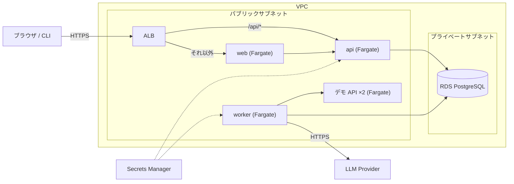

# AWS へのデプロイ

ParityLens を AWS に置くための Terraform。**この構成は `terraform validate` までしか確認していない。** 実際に `apply` して動かした実績はまだないので、初回は差分をよく読みながら進めること。

## 構成



| ファイル | 内容 |
|---|---|
| `network.tf` | VPC、サブネット、ルート |
| `security.tf` | セキュリティグループ。誰が誰に接続できるかを1ルール1リソースで書いてある |
| `database.tf` | RDS PostgreSQL |
| `secrets.tf` | Secrets Manager(DB 接続情報、マスターキー、OAuth と LLM のシークレット) |
| `ecr.tf` | コンテナイメージのリポジトリ |
| `ecs.tf` | クラスター、タスク定義、サービス、Service Connect |
| `alb.tf` | ロードバランサーとパスによる振り分け |
| `iam.tf` | タスクのロールと、GitHub Actions からデプロイするためのロール(OIDC) |

設計上の判断は [ADR 0010](../../docs/adr/0010-aws-architecture-and-cost.md) にある。

## 費用

常時起動で **月 100〜130 ドル程度**になる見込み(東京リージョン、2026 年時点の公開料金からの概算。実際の請求で確認すること)。

| 項目 | 月額の目安 |
|---|---|
| Fargate タスク 5 つ(0.25 vCPU / 0.5 GB) | 約 55 ドル |
| ALB | 約 20 ドル |
| RDS db.t4g.micro + 20 GB | 約 20 ドル |
| パブリック IPv4 アドレス(タスク 5 + ALB 2) | 約 25 ドル |
| Secrets Manager、CloudWatch Logs、ECR | 数ドル |

### 止め方

**一時的に止める。** `terraform apply -var desired_count=0` で全タスクが止まり、Fargate とタスクの IP アドレスの分(合計の6割ほど)がかからなくなる。残るのは ALB(と、その IP アドレス2つ)、RDS、ログなど。RDS はコンソールから停止できるが、停止中もストレージの料金はかかり、7日たつと自動で起動し直す。

**完全に消す。** 削除保護を外してから消す。

```bash
terraform apply -var allow_destroy=true   # RDS の削除保護を外し、イメージの残った ECR も消せるようにする
terraform destroy -var allow_destroy=true
```

RDS は、消える前に最終スナップショット(`paritylens-final`)を取る。スナップショットの保管にも料金がかかるので、要らなければ手で消すこと。

## 事前に用意するもの

1. AWS アカウントと、`terraform apply` を実行できる権限。Terraform は 1.10 以上
2. ドメイン名と、その ACM 証明書(同じリージョン)。セッション Cookie が `Secure` なので、HTTPS と実在のホスト名が必須
3. Google の OAuth クライアント(ID とシークレット)
4. (任意)Anthropic の API キー。指定すると AI 分析が有効になる
5. その AWS アカウントに GitHub の OIDC プロバイダー(`token.actions.githubusercontent.com`)がすでにあるなら、その ARN を `github_oidc_provider_arn` に指定する。1アカウントに1つしか作れないため、指定しないと `apply` が `EntityAlreadyExists` で失敗する

## 手順

```bash
cd infra/terraform
cp example.tfvars terraform.tfvars        # 編集する。terraform.tfvars はコミットされない
export TF_VAR_google_client_secret=...
export TF_VAR_anthropic_api_key=...       # 任意

terraform init
terraform plan                            # 作られるものを確認する
terraform apply
```

`apply` の出力に従って、次を行う。

1. `load_balancer_dns_name` に向けて、ドメインの CNAME(または Route 53 のエイリアス)を作る
2. `google_redirect_uri` を、Google の OAuth クライアントの「承認済みのリダイレクト URI」に登録する
3. GitHub リポジトリの Variables に `AWS_DEPLOY_ROLE_ARN`、`AWS_REGION`、`ECR_REGISTRY` を設定する。変数 `name` を既定(`paritylens`)から変えた場合は、`APP_NAME` にも同じ値を設定する
4. GitHub Actions の **Deploy** ワークフローを手動で実行する。イメージがビルドされ、ECR に push され、各サービスが新しいイメージに切り替わる

最初の `apply` の時点では ECR にイメージがないので、サービスは起動に失敗し続ける。手順 4 を実行すると起動する。

## 状態ファイル

Terraform の状態ファイルには、生成した DB パスワードとマスターキーが平文で入る。既定ではローカルに置かれるので、共有する場合は `versions.tf` のコメントにある S3 バックエンド(暗号化あり)に移すこと。`*.tfstate` は `.gitignore` に入っている。

**状態ファイルをなくさないこと。** マスターキーは Terraform が生成し、状態ファイルと Secrets Manager にしかない。両方を失うと、DB に暗号化して保存したシークレットは二度と復号できない。

## デプロイの動き

Deploy ワークフローは、コミットの SHA をタグにしてイメージを push し、各サービスのタスク定義を新しいリビジョンに切り替える。

- 同じコミットをもう一度デプロイすると、イメージのビルドと push は飛ばす(ECR のタグは上書きできない設定のため)
- 新しいタスクが起動に失敗すると、ECS は前のリビジョンに戻す。ワークフローは、切り替え後に「いま動いているのが、今回登録したリビジョンか」を確かめ、違えば失敗として終わる
- DB のマイグレーションは、api のタスクが起動するときに実行される。切り替えの間は、古い worker が新しいスキーマに対して数分動く。列を消す・NOT NULL にするといった、古いコードと両立しないマイグレーションは、2回のデプロイに分ける必要がある(先に新旧どちらのコードでも動く形にし、次のデプロイで古い形を消す)

## 確認できていない点

`apply` していないので、次は読んで判断しただけである。

- Service Connect のプロキシは各タスクに同居する。0.25 vCPU / 0.5 GB で足りるかは、動かしてみないとわからない(AWS は余裕を持たせることを勧めている)
- ALB のアイドルタイムアウト(60 秒)より、アプリ側の keep-alive(75 秒)を長くしてある。逆だと断続的に 502 が出るとされるが、この設定で出ないことは確認していない
- デプロイ用ワークフローは一度も実行していない

## 公開環境での制限

- worker が接続できるのはデモ API だけ(`PARITYLENS_EGRESS_MODE=allowlist`)。任意の URL を登録して実行することはできない。この制限をかけているのはアプリケーションである。セキュリティグループは、VPC の中で worker が届く先をデモ API と DB に絞っているが、443 番ポートはインターネットに開いており(LLM、ECR、Secrets Manager に必要)、メタデータエンドポイントへの通信もセキュリティグループでは止められない。後者は、エンジンがリンクローカルアドレスへの接続を常に拒否することと、タスクロールに権限がないことで守っている
- ログインは Google のみ。開発ログインは、本番設定では起動時に拒否される
