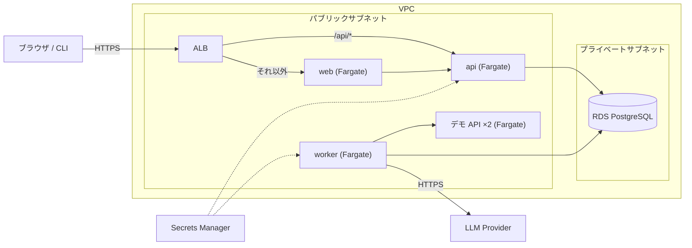

# AWS へのデプロイ

ParityLens を AWS に置くための Terraform。**この構成は `terraform validate` までしか確認していない。** 実際に `apply` して動かした実績はまだないので、初回は差分をよく読みながら進めること。

## 構成



| ファイル | 内容 |
|---|---|
| `network.tf` | VPC、サブネット、ルート |
| `security.tf` | セキュリティグループ。誰が誰に接続できるかを1ルール1リソースで書いてある |
| `database.tf` | RDS PostgreSQL |
| `secrets.tf` | Secrets Manager(DB 接続情報、マスターキー、OAuth と LLM のシークレット) |
| `ecr.tf` | コンテナイメージのリポジトリ |
| `ecs.tf` | クラスター、タスク定義、サービス、Service Connect |
| `alb.tf` | ロードバランサーとパスによる振り分け |
| `iam.tf` | タスクのロールと、GitHub Actions からデプロイするためのロール(OIDC) |

設計上の判断は [ADR 0010](../../docs/adr/0010-aws-architecture-and-cost.md) にある。

## 費用

常時起動で **月 100〜130 ドル程度**になる見込み(東京リージョン、2026 年時点の公開料金からの概算。実際の請求で確認すること)。

| 項目 | 月額の目安 |
|---|---|
| Fargate タスク 5 つ(0.25 vCPU / 0.5 GB) | 約 55 ドル |
| ALB | 約 20 ドル |
| RDS db.t4g.micro + 20 GB | 約 20 ドル |
| パブリック IPv4 アドレス(タスク 5 + ALB 2) | 約 25 ドル |
| Secrets Manager、CloudWatch Logs、ECR | 数ドル |

使わないときは、サービスの `desired_count` を 0 にし、RDS を停止すると、ALB と IP アドレスの分だけになる。完全に止めるなら `terraform destroy`(RDS は削除保護を外す必要がある)。

## 事前に用意するもの

1. AWS アカウントと、`terraform apply` を実行できる権限
2. ドメイン名と、その ACM 証明書(同じリージョン)。セッション Cookie が `Secure` なので、HTTPS と実在のホスト名が必須
3. Google の OAuth クライアント(ID とシークレット)
4. (任意)Anthropic の API キー。指定すると AI 分析が有効になる

## 手順

```bash
cd infra/terraform
cp example.tfvars terraform.tfvars        # 編集する。terraform.tfvars はコミットされない
export TF_VAR_google_client_secret=...
export TF_VAR_anthropic_api_key=...       # 任意

terraform init
terraform plan                            # 作られるものを確認する
terraform apply
```

`apply` の出力に従って、次を行う。

1. `load_balancer_dns_name` に向けて、ドメインの CNAME(または Route 53 のエイリアス)を作る
2. `google_redirect_uri` を、Google の OAuth クライアントの「承認済みのリダイレクト URI」に登録する
3. GitHub リポジトリの Variables に `AWS_DEPLOY_ROLE_ARN`、`AWS_REGION`、`ECR_REGISTRY` を設定する
4. GitHub Actions の **Deploy** ワークフローを手動で実行する。イメージがビルドされ、ECR に push され、各サービスが新しいイメージに切り替わる

最初の `apply` の時点では ECR にイメージがないので、サービスは起動に失敗し続ける。手順 4 を実行すると起動する。

## 状態ファイル

Terraform の状態ファイルには、生成した DB パスワードとマスターキーが平文で入る。既定ではローカルに置かれるので、共有する場合は `versions.tf` のコメントにある S3 バックエンド(暗号化あり)に移すこと。`*.tfstate` は `.gitignore` に入っている。

## 公開環境での制限

- worker が接続できるのはデモ API だけ(`PARITYLENS_EGRESS_MODE=allowlist`)。任意の URL を登録して実行することはできない。アプリケーションの検査に加えて、セキュリティグループでも同じ制限をかけてある
- ログインは Google のみ。開発ログインは、本番設定では起動時に拒否される
